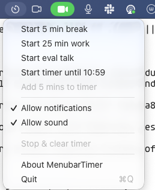

# MenubarTimer

> Small timer app that lives in menubar



- Counts down from 5, 25, or 45 minutes
- Counts down until the next :29 or :59
- Add extra 5 minutes to timer when running
- Optionally displays OS notification with/without sound after countdown is done
- When running, shows only the countdown (like `13:03`) and no icon
- Works with dark/light color scheme

Hat tip to [Camillo Visini](https://github.com/visini) for [this blog post](https://camillovisini.com/article/create-macos-menu-bar-app-pomodoro/) that the first, Python version was based on.

## Download

Get `MenubarTimer.app.zip` from the [latest release](https://github.com/phortuin/menubar-timer/releases/latest), unzip it and move the app to Applications. It needs macOS 27.

The app isn't notarized by Apple, so macOS blocks it the first time you open it. Go to System Settings → Privacy & Security, scroll down to the message about MenubarTimer and choose Open Anyway. After that it opens normally.

## Build

A native SwiftUI app for macOS 27. The Xcode project is generated with [XcodeGen](https://github.com/yonaskolb/XcodeGen):

```bash
$ brew install xcodegen
$ xcodegen
$ xcodebuild -scheme MenubarTimer -configuration Release -derivedDataPath build
$ cp -R build/Build/Products/Release/MenubarTimer.app /Applications/
```

To publish a release, raise `MARKETING_VERSION` in `project.yml`, commit and push, then run `scripts/release.sh`. It builds the app and creates the GitHub release with the zip, which needs the [GitHub CLI](https://cli.github.com).

Run the tests with `xcodebuild test -scheme MenubarTimer -destination 'platform=macOS'`. The app icon is drawn in code: `swift design/icon.swift` renders it into the asset catalog.

## Todo

- [ ] Sound can be turned off during an eval talk, and the setting goes back to what it was once that timer is done
- [ ] Buttons on the time's-up notification: +5 min, and start 5 min break
- [ ] End time in the menu while a timer runs
- [ ] A pie in the menu bar instead of, or next to, the countdown
- [ ] Focus (Do Not Disturb) during an eval talk, through a Shortcut
- [ ] Pause and resume
- [ ] A duration you type in yourself
- [ ] A simpler, more iconic app icon
- [ ] A readme screenshot of the menu over a plain desktop

## License

[MIT](license)
